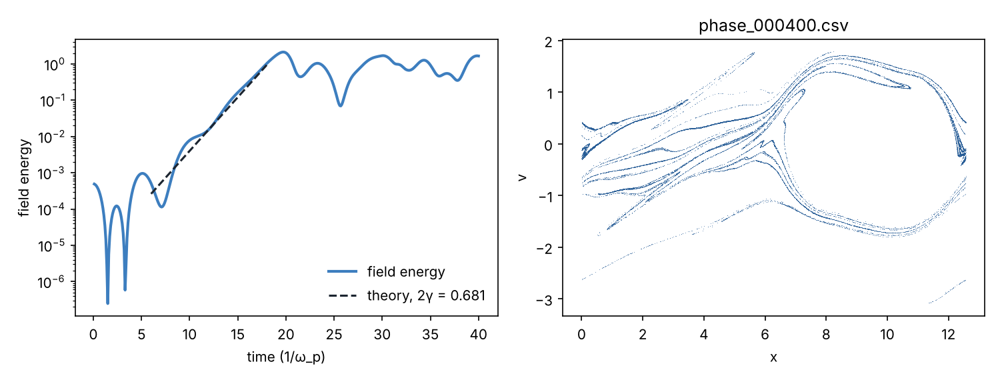

# kinetic_pic: a CMake C++ particle-in-cell example for laptop and HPC

A small, complete C++17 project accompanying Section 9 of
[Kinetic Hierarchies: from Liouville to Euler](https://dipakmunshi87.github.io/ML_Stat_Notes/kinetic_hierarchies.html).
It solves the 1D electrostatic Vlasov–Poisson system with particle-in-cell (the two-stream instability shown in
the note's animation), and is set up the way a production code would be:

* **CMake** with options for OpenMP, MPI, native tuning and tests, plus **CMakePresets** for laptop / debug / HPC
* **Hybrid parallelism**: OpenMP threads over particles, MPI ranks owning disjoint particle sets with an
  `MPI_Allreduce` of the charge density each step
* **ctest physics tests**: linear growth rate within 10% of the cold-beam dispersion relation, momentum conserved to
  round-off (no self-force), a single beam stays stable, and the growth-rate test again on 4 MPI ranks
* A **Slurm** job script with a strong-scaling sweep, and a plotting script

## Algorithm

Cloud-in-cell deposit → Gauss's law `dE/dx = 1 − n_e/n0` integrated on the staggered grid (face fields, then
averaged to nodes, i.e. central-difference E from the discrete Poisson solution) → CIC interpolation with the same
kernel → leapfrog push. Plasma units (ω_p = 1); box L = 4π so the fundamental mode has k = 0.5, which the
two-stream instability with beams at ±v0 = ±1 amplifies at γ = 0.341 ω_p (cold theory).

## Laptop

```bash
# macOS: brew install cmake libomp open-mpi      Ubuntu: sudo apt install cmake g++ libopenmpi-dev openmpi-bin
cmake --preset laptop
cmake --build --preset laptop -j
ctest --preset laptop                       # three physics tests, ~2 s
./build/laptop/pic_two_stream --particles 2000000 --tend 40 --snapshots 100 --out output
python3 scripts/plot_results.py output      # field energy vs theory + phase space
```

Without presets (older CMake): `cmake -S . -B build -DCMAKE_BUILD_TYPE=Release && cmake --build build -j && (cd build && ctest)`.

With MPI on a laptop: `cmake --preset laptop-mpi && cmake --build --preset laptop-mpi -j && ctest --preset laptop-mpi`,
then `OMP_NUM_THREADS=2 mpirun -np 4 ./build/laptop-mpi/pic_two_stream`.

Apple clang has no OpenMP by default; with `brew install libomp` CMake finds it, otherwise the build falls back to
serial with a warning. The `debug` preset builds with address and undefined-behaviour sanitizers.

## HPC

```bash
module load cmake gcc openmpi              # names vary by site
cmake --preset hpc && cmake --build --preset hpc -j 8
ctest --preset hpc                         # run on a compute node (srun/salloc) if login nodes forbid MPI
sbatch scripts/slurm_pic.sh                # production run + strong-scaling sweep
```

The `hpc` preset turns `-march=native` **off** so one binary runs on every node type; switch it on if you build on
the same hardware you run on. `scripts/slurm_pic.sh` sets `OMP_NUM_THREADS`, `OMP_PLACES` and `OMP_PROC_BIND`, binds
ranks to cores and writes `scaling_<jobid>.csv` (ranks, threads, seconds).

## Command-line options

`--particles N --grid NG --v0 V --vth S --dt DT --tend T --snapshots EVERY --out DIR`.
`N` must be divisible by 2 × (number of MPI ranks). Output: `DIR/diagnostics.csv` (time, field energy, kinetic
energy, momentum) and optional `DIR/phase_<step>.csv` subsamples.

## Measured here (for reference)

| Build | Particles | Ranks × threads | Growth rate (theory 0.341) | Throughput |
|---|---|---|---|---|
| OpenMP | 2×10⁶ | 1 × 2 | 0.333 | 9.7×10⁷ particle-steps/s on 2 cores |
| MPI + OpenMP | 4×10⁵ | 4 × 1 | 0.333 | 8×10⁷ particle-steps/s on 2 cores |

The measured rate sits a few per cent below cold theory because the beams have a small thermal spread.



## Layout

```
CMakeLists.txt  CMakePresets.json
include/pic/pic.hpp      src/pic.cpp (physics)  src/io.cpp (CSV, MPI gather)  src/main.cpp (driver)
tests/test_physics.cpp   scripts/slurm_pic.sh   scripts/plot_results.py
```
